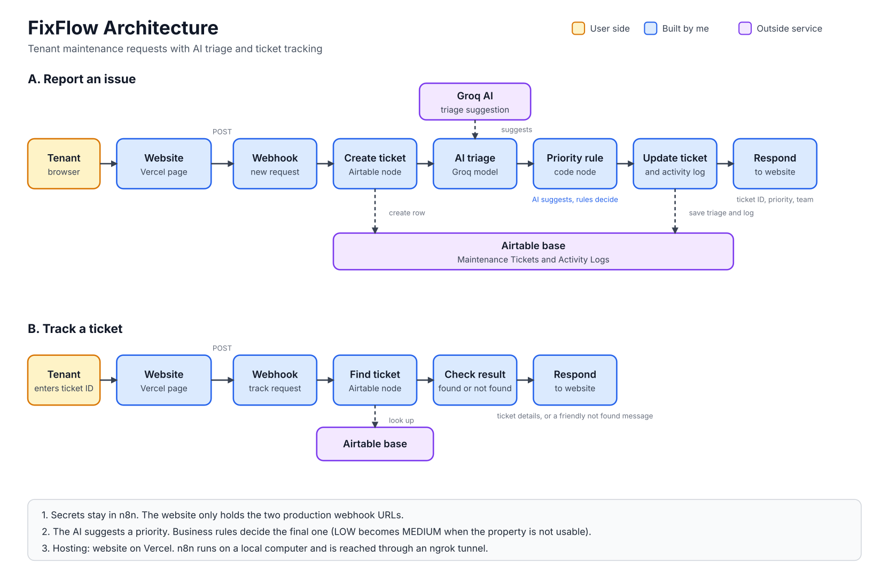

# FixFlow

FixFlow is a maintenance request tool for tenants. A tenant reports a problem on a simple website, an AI model sorts it into a category and suggests a priority, business rules decide the final priority, and the tenant gets a ticket ID. They can come back later and track the ticket status.

Built for the 10Alytics Business AI Automation Final Capstone.

**Live site:** https://fixflow-peach.vercel.app
**Code:** https://github.com/OmotayoOlasoji/fixflow

## The problem

Tenants usually report maintenance problems by phone or message. Requests get lost, nobody knows how urgent they are, and tenants have no way to check progress. FixFlow gives tenants one place to report an issue and follow it, and gives the property team a sorted, prioritised list in Airtable.

## How it works



Browser (Vercel) → n8n webhook → Airtable and Mistral AI → response back to the website.

**Workflow A: Report an issue** (`/webhook/fixflow-request`)
1. The website sends the form to the n8n webhook.
2. n8n builds a ticket ID and creates the ticket in Airtable.
3. Mistral AI returns a category, a suggested priority, a recommended team and a short summary.
4. A code node applies the business rule. The AI suggests, the rules decide.
5. n8n updates the ticket, writes a row in Activity Logs and returns the result to the website.

**Workflow B: Track a ticket** (`/webhook/fixflow-track`)
1. The website sends the ticket ID.
2. n8n looks it up in Airtable.
3. It returns the ticket details, or a friendly "not found" message.

## Business rules

- A ticket ID is created for every request in the format `FIX-YYYYMMDD-HHMMSS`.
- If the AI suggests LOW priority and the tenant says the property is not usable, the final priority is raised to MEDIUM.
- The AI prompt includes the tenant's "property usable" answer and is told not to contradict it, so summaries cannot invent facts.
- New tickets start with the status RECEIVED.
- Every created ticket also gets a row in the Activity Logs table.

## Airtable structure

**Maintenance Tickets:** Ticket ID, Tenant Name, Email, Phone, Property, Issue Type, Description, Started At, Property Usable, Category, Priority, Recommended Team, AI Summary, Status, Created At, Updated At.

**Activity Logs:** Log ID, Ticket ID, Action, Created At.

## Tests

Evidence (screenshots and a results table) is in the shared test log linked at the end of this README. Summary:

| Test | Result |
|---|---|
| TC1 Normal plumbing issue | Pass |
| TC2 Priority rule (LOW raised to MEDIUM) | Pass |
| TC3 Track a real ticket | Pass |
| TC4 Track an unknown ticket | Pass |
| TC5 Status change shows when tracked | Pass |
| TC6 Invalid form is blocked | Pass |
| TC10 Submit on the public site | Pass |
| TC11 Track on the public site | Pass |
| TC12 Unknown ticket on the public site | Pass |

## Setup notes

**Frontend (Vite)**
```
npm install
npm run dev
```
Open http://localhost:5173. The two webhook URLs are in the `CONFIG` block near the top of the script in `index.html`. Only webhook URLs are in the frontend. No keys or tokens.

**n8n**
1. Import both files from the `n8n` folder (`fixflow-submit-workflow.json` and `fixflow-track-workflow.json`).
2. Add your own Airtable credential and Mistral credential in n8n.
3. In the Airtable create node, Typecast is switched on so single select values are accepted.
4. In both Webhook nodes, set Allowed Origins (CORS) to your local and deployed site addresses.
5. Publish both workflows so the production webhook URLs (`/webhook/...`) are active.

**Hosting**
- The website is hosted on Vercel and deploys from this repository.
- n8n runs on a local computer and is exposed with an ngrok tunnel. The webhooks only work while n8n and ngrok are running. If the ngrok address changes, update the two URLs in `CONFIG` and redeploy.

## Known limits and future improvements

- n8n runs locally through ngrok. A hosted n8n would keep the webhooks online all the time.
- Status changes are made by hand in Airtable. A third workflow for admins to update a ticket status is a planned next step.
- Email or SMS updates when the status changes.
- Contractor assignment for each ticket.
- A safe fallback if the AI returns invalid JSON (for example, set the category to Other and the priority to MEDIUM).
- The "Other" issue type is not offered in the form yet.

## Links

- Test log: https://docs.google.com/spreadsheets/d/1pOQVMi_vL2e0GrIqroxdLwvahIbK5Zacq4mYkdRyj8E/edit?usp=sharing
- Evidence folder: https://drive.google.com/drive/folders/1jnh4XNbfKnIpJDmenNfegsL6RO2yQTax?usp=sharing

Built by Omotayo Olasoji.
